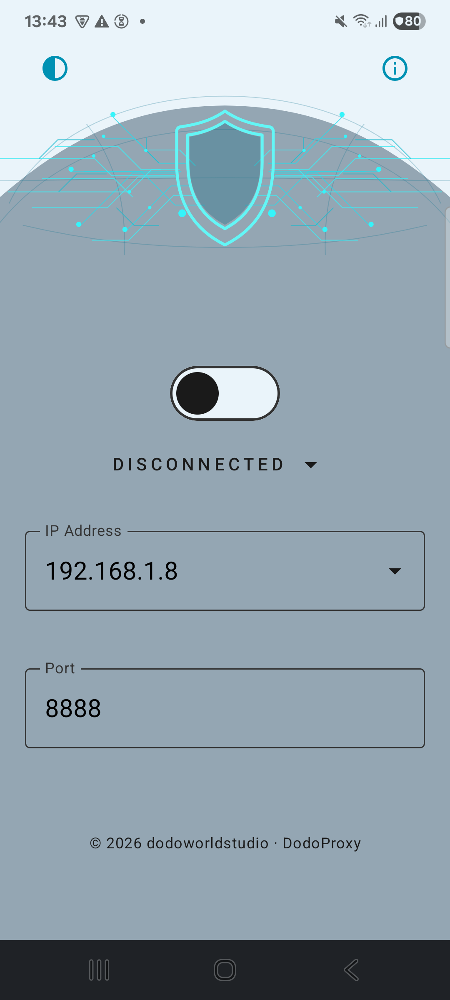
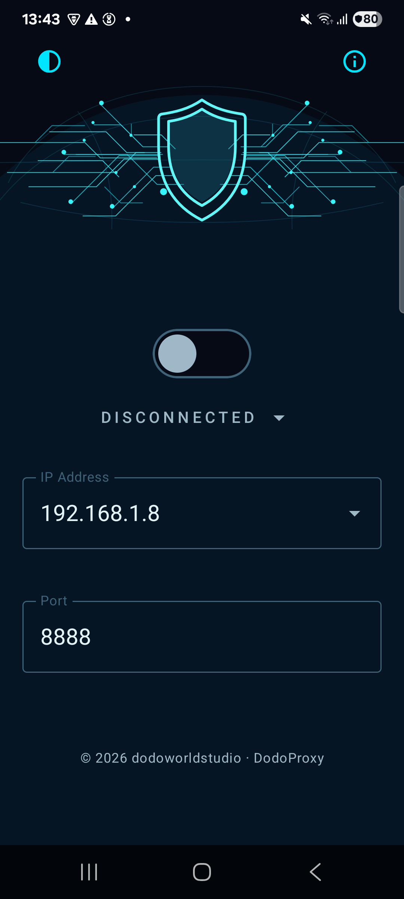

# DodoProxy

DodoProxy configures Android's global HTTP proxy for apps that honor the system proxy setting. Enter a proxy host and port to connect, then disconnect in the app to restore the previous setting.

## Features

- Configure and clear Android's global HTTP proxy.
- Validate the proxy host and port before applying settings.
- Remember the entered host and port.
- Restore the previous proxy when disconnecting, without overwriting a setting changed by another app or user.
- Translations in 40 locales: Arabic, Bengali, Chinese (Simplified and Traditional), Czech, Dutch, English, Filipino, Finnish, French, German, Greek, Gujarati, Hebrew, Hindi, Hungarian, Indonesian, Italian, Japanese, Kannada, Korean, Malay, Malayalam, Marathi, Persian, Polish, Portuguese (Brazil and Portugal), Romanian, Russian, Spanish, Swahili, Swedish, Tamil, Telugu, Thai, Turkish, Ukrainian, Urdu, and Vietnamese. Supports Android's per-app language settings on Android 13 and later.

## Screenshots

| Light mode | Dark mode |
|:--:|:--:|
|  |  |

## Requirements

- Android 6.0 (API 23) or later.
- Android Studio, or a compatible JDK to build with the included Gradle wrapper (only if building from source).
- `WRITE_SECURE_SETTINGS` permission granted through ADB. This protected permission cannot be granted through the normal Android runtime-permission prompt.

## Download APK

Download [DodoProxy v1.0 debug APK](apk/DodoProxy-v1.0-debug.apk) and install it on an Android 6.0 or newer device. If Android prompts you to allow installation from your browser or file manager, grant permission to that source.

This is a **debug build**, signed with a development key for testing, not a production release. To update an existing installation, the new APK must be signed with the same key; otherwise uninstall the old app first (after disabling its proxy). Follow the ADB permission step below before connecting a proxy.

## Build

Open the project in Android Studio and run the `app` configuration, or build a debug APK from the project root:

```sh
./gradlew assembleDebug
```

The generated APK is at `app/build/outputs/apk/debug/app-debug.apk`. The downloadable copy in `apk/` must be replaced when shipping a new version.

## Setup and usage

1. Enable USB debugging on the Android device and connect it to a computer with ADB installed.
2. Grant the permission once:

   ```sh
   adb shell pm grant com.dodo.proxytoggle android.permission.WRITE_SECURE_SETTINGS
   ```

3. Open DodoProxy, enter the proxy host and port, and connect. Use the app's disconnect action to restore the previous setting.

The app provides a copyable permission command if access has not been granted. Disable the proxy in DodoProxy before uninstalling; Android may retain the global proxy setting after the app is removed.

The global proxy only affects apps that use Android's system proxy. App behavior may vary by Android version, network, and app implementation. Use only proxy servers you trust.

## Project structure

- `presentation` — Jetpack Compose UI and `ProxyViewModel`
- `domain` — proxy validation, models, and actions
- `data` — Android settings and preference access

## Contributing

Contributions are welcome. Please open an issue to discuss substantial changes, and submit pull requests with a clear description of the change and relevant validation steps.

## License

Copyright (c) 2026 dodoworldstudio

DodoProxy is free to use, modify, and distribute under the [MIT License](LICENSE). See the license for the applicable terms and warranty disclaimer.
